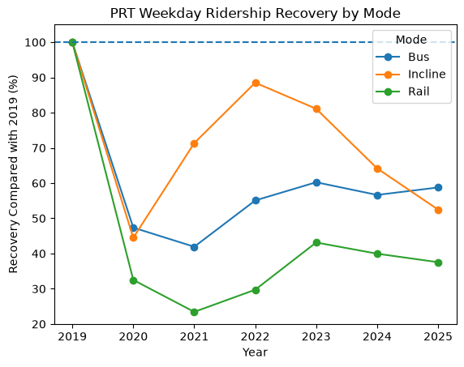

# Pittsburgh Regional Transit Ridership Recovery

## Research Question

How did weekday ridership recovery after COVID-19 differ across Pittsburgh Regional Transit bus, rail, and incline service compared with 2019 levels?

## Bottom Line

By 2025, weekday ridership had recovered to:

- **58.8%** of 2019 levels for Bus
- **52.5%** of 2019 levels for Incline
- **37.5%** of 2019 levels for Rail

Bus had the strongest weekday ridership recovery by 2025, while Rail remained the furthest below its pre-COVID level.

## Why This Matters

The recovery patterns were not the same across PRT's transportation modes. This means that treating Bus, Rail, and Incline the same when making future service and funding decisions may not make sense.

Understanding which modes have recovered more strongly can help PRT decide where service expansion may be most useful, where service may need to be adjusted, and where additional investment may not currently be supported by ridership demand.

## About the Dataset

I used the Pittsburgh Regional Transit Monthly Average Ridership by Route dataset from the Western Pennsylvania Regional Data Center.

The original dataset contained **26,483 rows** and included monthly ridership data from **2017 through April 2026**.

One row represents the average ridership for one PRT route, in one month, for one day type.

The main columns used in this project were:

- `Route`
- `Mode`
- `Month_Start`
- `Day_Type`
- `Avg_Riders`

The dataset included three transportation modes:

- Bus
- Rail
- Incline

For the final analysis, I focused only on **weekday ridership from 2019 through 2025**.

I chose **2019 as the baseline** because it was the last full pre-COVID year, which made it the clearest comparison point for measuring how much ridership had recovered afterward.

I did **not include 2026 in the final yearly comparison** because the dataset only contained data from January through April 2026. Comparing only four months of 2026 with complete 12-month years like 2019 through 2025 could create a misleading result, especially because ridership can change throughout the year and may be affected by seasonality. Rather than treat a partial year as if it were directly comparable with a full year, I ended the main analysis at 2025.

The 2026 data were still useful for understanding what was available in the dataset, but they were excluded from the final recovery calculations so the year-to-year comparison would be more consistent.

## Data Cleaning and Decisions

Before analyzing ridership recovery, I cleaned and checked the dataset to make sure the comparisons were reliable.

### Duplicate and Structure Checks

I checked for exact duplicate rows and duplicate combinations of route, mode, month, and day type. No duplicate records were found, so each observation represented a unique route-month-day type combination.

I also checked the data types and made sure the major categorical fields, including `Mode` and `Day_Type`, were consistent.

### Negative Ridership Values

I found **7 records with negative values in `Avg_Riders`**. Since negative ridership is not realistic, I treated these values as missing rather than keeping them in the analysis or changing them to zero.

I chose this approach because setting them to zero would imply that there were definitely no riders, while the negative values were more likely the result of an error or adjustment in the source data.

### Date Preparation

I converted `Month_Start` into a date format and created a separate `Year` column. This made it easier to group the data by year and compare post-COVID ridership with the 2019 baseline.

### MNT and MNT1 Route Records

I found that the route codes `MNT` and `MNT1` appeared under more than one transportation mode. Since the main purpose of the project was to compare Bus, Rail, and Incline recovery, inconsistent mode classifications could affect the results.

These records also had very small ridership totals compared with the rest of the system, so I excluded `MNT` and `MNT1` from the final analysis.

I did not delete them from the cleaned master dataset. Instead, I excluded them only from the analysis subset so the original cleaned data would remain complete.

### Route 68

Route 68 also had missing route name and garage information, so I checked it separately. Unlike MNT and MNT1, Route 68 remained consistently classified as Bus and appeared to represent real service rather than a coding error.

Because of that, I kept Route 68 in the analysis.

### Final Cleaned Dataset

After cleaning, I saved a separate cleaned version of the dataset and kept the original file unchanged. This allowed me to preserve the raw data while using a more reliable version for the final analysis.

## Preparing the Data for Analysis

After cleaning the full dataset, I created a smaller analysis subset that matched the research question.

The final analysis included:

- **Weekday ridership only**
- **Years 2019 through 2025**
- **Bus, Rail, and Incline service**
- Exclusion of the inconsistent `MNT` and `MNT1` route records

This left **8,309 rows** in the analysis dataset.

I focused on weekdays because commuting patterns were a major part of the question, and weekday ridership was the most consistent way to compare how regular transit use changed after COVID-19.

I also compared each transportation mode with **its own 2019 ridership level** rather than comparing the raw ridership totals of Bus, Rail, and Incline directly.

This was important because the three modes operate at very different scales. Bus has many more routes and riders than Rail or Incline, so comparing total ridership alone would mostly show which mode is larger.

Instead, I treated each mode's 2019 ridership as **100%** and measured how much of that level had returned in each later year. This made the comparison about **recovery**, not size.

## Challenges and Confounding Variables

One of the biggest challenges in this project was making sure the ridership comparisons were fair and not misleading.

### Incomplete Incline Data

Bus and Rail had complete monthly coverage from 2019 through 2025, but Incline did not.

Incline had:

- 7 months of data in 2022
- 10 months of data in 2023
- 11 months of data in 2024

Because Incline ridership also changes a lot by season, I did not want to compare an incomplete year with all 12 months of 2019. That could make recovery look higher or lower simply because certain high- or low-ridership months were missing.

To fix this, I used a **matched-month comparison**. For example, if only January through July were available in 2022, I compared those months with January through July of 2019.

### Seasonality

I checked average ridership by month and found that seasonality was especially important for the Incline. Ridership was much higher in some months than others.

Because of this, missing months could have a large effect on the yearly average, which is another reason I used the matched-month method for Incline.

### Changes in Rail Route Coding

I also found a change in Rail route coding in 2024 and 2025 because an additional route code, `SWL`, appeared in the dataset.

I kept these records because they were still classified as Rail, but I treated the change as a possible confounding factor when interpreting Rail recovery over time.

### Real-World Factors Beyond COVID-19

The analysis measures ridership recovery compared with 2019, but it does not prove that COVID-19 was the only reason ridership changed.

Other factors could include:

- Changes in remote work and commuting
- Service changes or construction
- Changes in where people live and work
- Tourism, especially for the Incline
- Different travel purposes across Bus, Rail, and Incline
- Broader changes in transportation behavior

Because of these factors, I treated the results as evidence of different recovery patterns across modes rather than proof that one single cause explains every change.

## How I Analyzed Ridership Recovery

After cleaning and filtering the data, I grouped weekday ridership by year, month, and transportation mode.

For Bus and Rail, I first summed route-level ridership within each month to create a monthly total for each mode. I then calculated the average monthly ridership for each year.

Next, I calculated a **2019 baseline** for each transportation mode. Each mode's 2019 value was treated as **100%**, and every later year was measured as a percentage of that baseline.

For example:

Recovery Percentage = (Current Year Ridership / 2019 Ridership) × 100

This allowed me to compare how much of each mode's pre-COVID weekday ridership had returned, even though Bus, Rail, and Incline operate at very different ridership levels.

### Incline Calculation

Incline required a different approach because several years were missing months.

Instead of comparing an incomplete year with all 12 months of 2019, I compared only the months that were available in that year with those same months in 2019.

For example, if 2022 only had January through July available, I compared January through July 2022 with January through July 2019.

This reduced the effect of seasonality and made the Incline comparison more consistent.

### Year-over-Year Change

I also calculated the change in recovery from one year to the next using **percentage points**.

For example, Bus increased from 41.9% recovery in 2021 to 55.1% in 2022, which was an increase of **13.1 percentage points**.

I used percentage-point changes because they were easier to interpret than calculating a percent change in the recovery percentage itself.

## Results

The final recovery percentages were:

| Year | Bus | Incline | Rail |
|---|---:|---:|---:|
| 2019 | 100.0% | 100.0% | 100.0% |
| 2020 | 47.4% | 44.5% | 32.5% |
| 2021 | 41.9% | 71.4% | 23.4% |
| 2022 | 55.1% | 88.5% | 29.7% |
| 2023 | 60.2% | 81.1% | 43.1% |
| 2024 | 56.6% | 64.2% | 40.0% |
| 2025 | 58.8% | 52.5% | 37.5% |

By 2025, Bus had the strongest weekday ridership recovery at **58.8% of its 2019 level**.

Incline was at 52.5%, although its trend needs to be interpreted more carefully because several years had incomplete monthly coverage and Incline ridership showed strong seasonality.

Rail had the weakest recovery at **37.5% of its 2019 level**.

Bus and Rail both reached their strongest post-2019 recovery levels in 2023, but Bus remained noticeably stronger throughout the later years.

## Ridership Recovery Trend

## What the Results Mean

The results show that PRT's transportation modes did not recover at the same rate after 2019.

Bus recovered more strongly than Rail and ended 2025 at 58.8% of its 2019 weekday ridership level. Rail remained much lower, ending 2025 at only 37.5% of its 2019 level.

Incline followed a different pattern. It recovered much more strongly through 2022, but then declined in 2023, 2024, and 2025. Because of the missing months and service interruptions, I would be more cautious when using the Incline results to make funding decisions.

The biggest takeaway is that PRT should not treat Bus, Rail, and Incline as if they are recovering in the same way.

Bus appears to have the strongest current demand relative to its pre-COVID level, while Rail has shown the weakest recovery. This suggests that future service and funding decisions should be more targeted by mode instead of using the same strategy across the entire transit system.

## Recommendation and Action Plan

Based on the recovery patterns, I would recommend that PRT prioritize future discretionary service-expansion resources toward Bus.

Bus had the strongest weekday recovery by 2025, reaching 58.8% of its 2019 level. Because of this, I would prioritize new service-expansion funding, frequency improvements, and additional operating resources toward Bus rather than broadly expanding Rail or Incline service.

For Rail, I would recommend maintaining essential existing service but avoiding broad expansion for the next budget cycle. Rail ended 2025 at only 37.5% of its 2019 weekday ridership level, so I do not think the current recovery pattern supports making Rail the priority for new expansion funding.

For the Incline, I would focus spending on maintenance and reliability rather than expansion. Several years had incomplete monthly coverage, and strong seasonality makes its recovery trend more difficult to compare directly with Bus and Rail.

Overall, my recommended plan is:

- Prioritize Bus for new discretionary service-expansion funding
- Maintain essential Rail service, but do not prioritize broad Rail expansion right now
- Focus Incline funding on maintenance and reliability
- Keep existing service needs, accessibility, and rider dependence in mind before making service cuts
- Reevaluate the funding strategy after another full year of ridership data

This recommendation does not call for a specific percentage cut to Rail because the dataset does not include operating costs, current budgets, capacity, or rider-need information.

## Limitations and Missing Information

This analysis shows how weekday ridership recovery differed across Bus, Rail, and Incline, but the dataset does not explain every reason behind those differences.

Some important information was not available in the dataset, including:

- Operating costs for each transportation mode
- The amount of funding currently assigned to Bus, Rail, and Incline
- Rider demographics or trip purpose
- Whether riders were commuting to work, school, or traveling for other reasons
- Station-level Rail demand
- Time-of-day ridership patterns
- The effect of remote work on specific routes
- Capacity differences between Bus, Rail, and Incline
- The impact of service frequency changes on ridership

Because of these limitations, my recommendation is focused on the direction PRT should take with future discretionary resources rather than recommending an exact dollar amount or exact percentage cut.

For example, the analysis supports prioritizing Bus expansion over broad Rail expansion, but it does not provide enough information to say that Rail funding should be cut by a specific percentage.

The results should therefore be used as a starting point for targeted service and funding decisions, while also considering cost, capacity, accessibility, and rider needs.

## Project Files

This repository includes the files used to clean, analyze, and document the project.

- `proposal.md` — Original project proposal and research question
- `Prt data cleaning.ipynb` — Data cleaning and quality checks
- `prt_analysis.ipynb` — Final analysis, calculations, tables, and visualization
- `Data/prt_monthly_ridership.csv` — Original dataset
- `Data/prt_monthly_ridership_clean.csv` — Cleaned dataset used for analysis

The original dataset was kept unchanged, and all cleaning decisions were made in a separate cleaned file so the analysis could be reproduced.